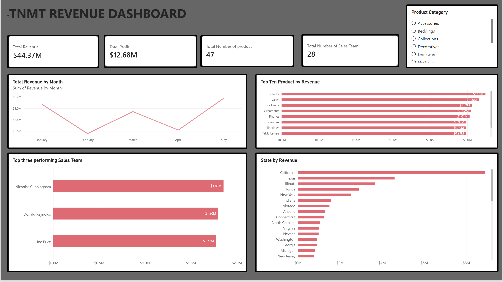

# TNMT Revenue Analysis Dashboard \| Power BI

## Project Overview

The **TNMT Revenue Analysis Dashboard** is an interactive business
intelligence project developed with **Microsoft Power BI** to analyse
revenue performance, profitability, product contribution, sales team
performance, and geographical sales distribution.

The dashboard brings key business metrics together in one place, making
it easier for stakeholders to monitor performance, identify revenue
drivers, compare results, and make informed, data-driven decisions.

## Dashboard Preview

*The dashboard provides a consolidated view of business performance,
with a product category slicer for interactive filtering.*

## Business Objectives

The project was designed to help answer important business questions:

-   How much revenue and profit has the business generated?
-   How does revenue change from month to month?
-   Which products contribute the most to revenue?
-   Which sales team members generate the highest revenue?
-   Which states contribute most to overall revenue?
-   How can performance be explored across different product categories?

## Key Performance Indicators (KPIs)

The dashboard highlights four headline metrics:

  KPI                                    Dashboard Result
  ------------------------------------ ------------------
  Total Revenue                              **\$44.37M**
  Total Profit                               **\$12.68M**
  Total Number of Products                         **47**
  Total Number of Sales Team Members               **28**

These indicators provide a quick overview of the business's revenue,
profitability, product range, and sales team size.

## Dashboard Features & Visualisations

### 1. Revenue Trend by Month

A monthly trend visual showing how revenue changes over time. It helps
stakeholders identify stronger and weaker months and monitor revenue
patterns.

### 2. Top 10 Products by Revenue

A ranked horizontal bar chart highlighting the products generating the
highest revenue. This can support product performance reviews, inventory
discussions, and sales planning.

### 3. Top Three Performing Sales Team Members

A comparison of the three highest-revenue sales team members, making it
easier to recognise top performers and assess individual sales
contributions.

### 4. Revenue by State

A geographical performance breakdown that compares revenue across
states. It can help identify high-performing markets and areas that may
need additional attention.

### 5. Product Category Slicer

An interactive slicer that allows users to filter the dashboard by
product category and explore performance from different product
segments.

## Key Insights from the Dashboard

Based on the figures visible in the dashboard:

-   **Revenue and profitability:** The business generated **\$44.37M in
    revenue** and **\$12.68M in profit**.
-   **Monthly performance:** Revenue fluctuates across the months
    displayed. May records the highest visible monthly revenue, while
    February records the lowest.
-   **Product contribution:** Clocks, vases, cookware, ornaments, and
    phones appear among the leading products by revenue.
-   **Sales team performance:** Nicholas Cunningham, Donald Reynolds,
    and Joe Price are the top three sales team members by revenue in the
    displayed results.
-   **Geographical performance:** California leads the displayed state
    revenue ranking, followed by Texas and Illinois.

These observations provide a starting point for further investigation
into sales trends, product strategy, regional opportunities, and team
performance.

## Tools & Skills Demonstrated

-   **Microsoft Power BI** -- Dashboard development and data
    visualisation
-   **Business Intelligence** -- Translating business data into useful
    performance information
-   **Data Analysis** -- Reviewing revenue, profit, product, team, and
    regional performance
-   **KPI Reporting** -- Presenting key metrics in a clear, accessible
    format
-   **Interactive Reporting** -- Using slicers to support dynamic data
    exploration
-   **Analytical Storytelling** -- Communicating findings through visual
    reports

## Business Value

This dashboard demonstrates how a well-structured BI report can make
business performance easier to understand and monitor. It gives
decision-makers a consolidated view of important metrics and helps
direct attention towards:

-   Revenue trends and changes over time
-   High-performing products and potential product opportunities
-   Sales team performance and contribution
-   Strong and underperforming geographical markets
-   Performance differences across product categories

## Project Files

  -----------------------------------------------------------------------
  File                                Description
  ----------------------------------- -----------------------------------
  `TNMT_DASHBOARD.png`                Screenshot preview of the completed
                                      Power BI dashboard

  `TNMT_Revenue_Dashboard.pbix`       Power BI project file *(add this
                                      file to the repository if you
                                      intend to share the interactive
                                      report)*
  -----------------------------------------------------------------------

## How to Explore the Project

1.  Clone or download this repository.
2.  Open `TNMT_Revenue_Dashboard.pbix` in Microsoft Power BI Desktop, if
    the PBIX file is included.
3.  Use the product category slicer to filter the report.
4.  Explore the KPI cards and charts to investigate revenue, profit,
    products, sales team performance, and state-level results.

## Conclusion

The TNMT Revenue Analysis Dashboard reflects my ability to use Power BI
to organise business data, develop meaningful visualisations, track
performance indicators, and communicate insights in a format that
supports business decision-making.

I built this project as part of my continued development in **data
analytics and business intelligence**, with a focus on turning data into
insights that businesses can act on.

------------------------------------------------------------------------

**Thank you for viewing my project!**

If you have feedback or suggestions, I would be happy to connect and
learn from your perspective.
